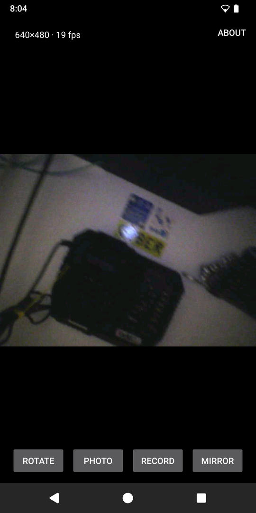

I have one of those cheap Chinese USB endoscopes. The stickers on it say **J106** and **J108** (yes, two different ones), and on USB it shows up as:

```
ID 2ce3:3828 Geek szitman supercamera
```

It looks like a webcam, but it isn't one. It does not implement UVC, so no camera app on any system recognises it. The only official way to use it is a closed vendor app for Android and iOS, which I would rather not have on my phone. So I wrote my own.

## What the app does

Not much, on purpose. You plug the endoscope into the phone, Android asks whether to open the app and whether it may use the USB device, and the picture shows up.



There are four buttons. **Photo** saves the current frame to `Pictures/Endoscope`, and **Record** saves a video to `Movies/Endoscope`, as an ordinary MP4 that the gallery plays. **Rotate** and **Mirror** are there because I never manage to hold the camera the right way up once it is inside something. Whatever is on the screen is what gets saved, rotated or not. The button on the endoscope's handle takes a photo as well.

Root is not needed, and the app asks for no permissions apart from the USB device itself. It should run on anything with Android 7 or newer and a USB port that can act as a host (OTG). I use it on a Pixel 2 XL with LineageOS.

Do not expect much from the picture. The box promises HD, but the camera sends 640×480 at around 18 frames per second, and no app can get more out of it.

## How the camera talks

The protocol was already figured out by other people, for Linux. [hbens/geek-szitman-supercamera](https://github.com/hbens/geek-szitman-supercamera) is a user space viewer and [MAkcanca/useeplus-linux-driver](https://github.com/MAkcanca/useeplus-linux-driver) is a kernel driver, which I had used on my PC before. I only had to check it against my own device and carry it over to Android.

The device has two vendor-specific USB interfaces, with bulk endpoints only:

| Interface | Endpoints | Use |
|---|---|---|
| 0 | `0x02` OUT, `0x82` IN | control |
| 1, alternate setting 1 | `0x01` OUT, `0x81` IN | video stream |

Starting the stream takes two short writes: `FF 55 FF 55 EE 10` to endpoint `0x02`, then `BB AA 05 00 00` to endpoint `0x01`. After that the camera keeps sending packets on `0x81`, each with a 12-byte header:

| Offset | Size | Field |
|---|---|---|
| 0 | 2 | magic `AA BB` |
| 2 | 1 | camera id |
| 3 | 2 | payload length, little-endian |
| 5 | 1 | frame id, increments with every video frame |
| 6 | 1 | camera number |
| 7 | 1 | flags, one of them is the button on the handle |
| 8 | 4 | g-sensor data |
| 12 | … | JPEG data |

A video frame is simply one JPEG image, split over the packets that share a frame id. So the "video" is plain MJPEG, and showing it means gluing the pieces together and decoding one JPEG after another.

One small surprise on my unit: the "camera number" byte flips between 0 and 1 on every frame, although there is only one lens and both show the same picture. On the models with two cameras that field presumably means something. Here the frame id is the only thing that can be trusted to separate frames.

## On Android

Android lets a regular app talk to a USB device directly, through the USB host API. That is all the app uses: it claims the two interfaces, sends the two commands and reads the stream in a loop. There is no native code and no library dependencies, just Kotlin and the Android framework.

A few details that turned out to matter:

* The part that parses the stream is plain Kotlin with no Android in it. It does not assume that a USB read returns exactly one packet, and it finds its place again after garbage. That made it possible to test it on a PC against a raw capture from the real endoscope.
* Reading from USB and drawing happen on separate threads. If the phone is slow to draw, frames are dropped on the screen instead of data being lost on the cable.
* For video, the JPEG frames are re-encoded to H.264 with the phone's hardware encoder. Each frame gets the time it actually arrived, so the uneven frame rate of the camera still plays back at the right speed.

Before writing any Android code I wrote a small C program with libusb that does the same handshake on Linux and dumps the raw stream to a file. It is in the repository too, and it is a handy way to check a different hardware revision from a PC.

## Source code

The project is open source under the GPLv3 or later: **[code.blago.cloud/blago/GeekSzitmanEndosocpeAndroid](https://code.blago.cloud/blago/GeekSzitmanEndosocpeAndroid)**. The README covers building and installing the app and describes the protocol.

If you have one of these endoscopes with a different USB ID or a different model sticker and it does not work, let me know. Patches are welcome too. The repository lives on my personal Forgejo, where you most likely have no account, so a pull request is not practical. Send the patch by mail instead, made with `git format-patch` or `git send-email`, to [blagovest@petrovs.info](mailto:blagovest@petrovs.info).

## Credits

* [hbens/geek-szitman-supercamera](https://github.com/hbens/geek-szitman-supercamera) for the description of the protocol.
* [MAkcanca/useeplus-linux-driver](https://github.com/MAkcanca/useeplus-linux-driver), the Linux kernel driver.
